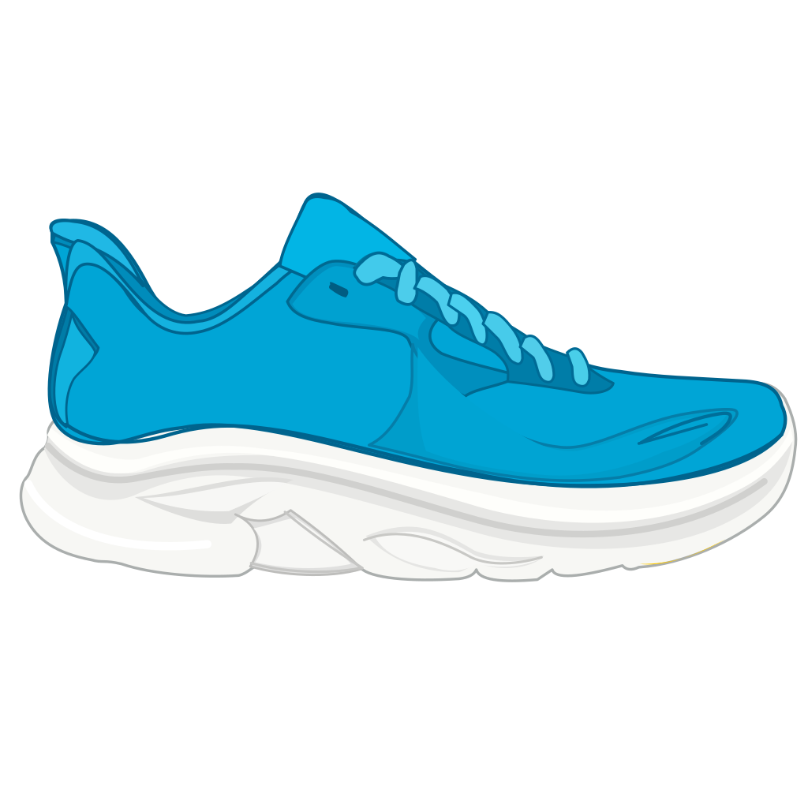

<p align="center"></p>

# Hobby Jogger

A CNC controller and CAM-lite for hobby desktop CNCs, starting with the Makera Z1. An alternative
to Makera Studio. Early days: the desktop app connects over WiFi or USB and does status, jogging,
homing, work offsets, a console, and G-code jobs (an editor with highlighting, completion and
checks, a toolpath preview on the bed, upload, run/pause/stop and an SD card browser). Probing and
toolpath generators come next.

## Layout

- `app` — the desktop app (Tauri; React for presentation only).
- `crates/hj-core` — app state and machine logic, synced to the frontend as patches.
- `crates/hj-makera` — Makera framed protocol: frame codec, status/diagnose parsing, TCP and USB
  transports, WiFi discovery.
- `crates/hj-gcode` — G-code analysis for the preview and checks.
- `crates/hj-sim` — a simulated Z1 for tests and for trying the app without a machine.
- `crates/hj-cli` — `hj`, a low-level tool for talking to the machine.
- `docs/architecture.md` — how the pieces fit together.
- `docs/research` — protocol notes and prior art.
- `packaging/linux` — udev rule for USB access.

## App

```bash
cd app && pnpm install && pnpm tauri dev
```

## `hj`

```bash
cargo run -p hj-cli -- discover
```

```bash
cargo run -p hj-cli -- query --discover --log z1.jsonl
```

```bash
cargo run -p hj-cli -- console --tcp 192.168.1.50
```

```bash
cargo run -p hj-cli -- usb
```

- `discover` listens for the machine's UDP broadcasts.
- `usb` lists attached Z1s with their USB descriptors.
- `query` connects (`--tcp HOST[:PORT]`, `--usb` or `--discover`), asks for status, `version`,
  `model`, `ftype` and `diagnose`, and prints what comes back.
- `console` polls status and sends each line you type as a command. `/help` lists extras such as
  feed hold and halt. **Commands are sent verbatim, including motion.**
- `--log FILE` appends every frame in both directions as JSON lines.

On Linux, USB access needs `packaging/linux/99-makera-z1.rules` installed.

## License

GPL-3.0-or-later.
